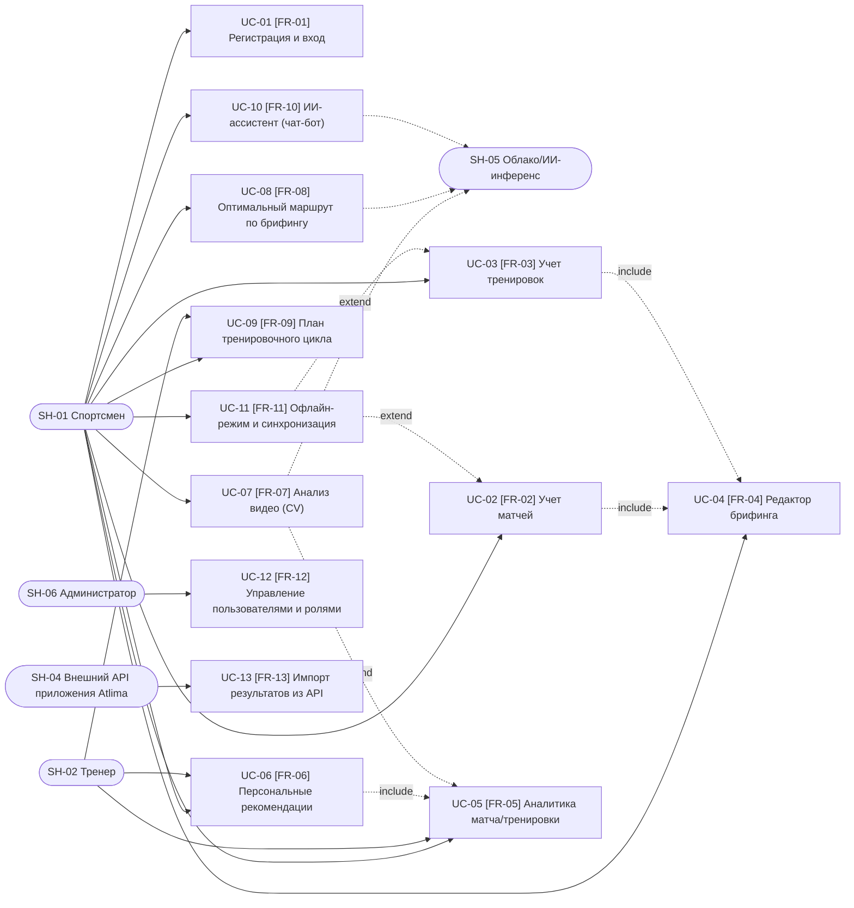

# Лабораторная работа №1. Формулирование требований к программной системе

| Поле | Значение |
|---|---|
| **Студент** | Шарипова Виктория Олеговна |
| **Группа** | РИС-23-3 |
| **Вариант** | ВКР — «Разработка интеллектуальной системы поддержки тренировочного процесса спортсмена-стрелка» |
| **Постановка задачи** | см. README.md |
| **Репозиторий** | https://github.com/vsharipova/tactix-vkr |
| **Дата сдачи** | 25.11.26 |

**Тема:** Анализ предметной области и формулирование требований к программной системе.

**Цель работы:** Научиться анализировать поставленную задачу, выделять заинтересованных лиц, формулировать функциональные и нефункциональные требования, представлять результаты в виде диаграммы вариантов использования.

---

## Краткое описание системы

«TactiX» - интеллектуальная система поддержки тренировочного процесса спортсменов-стрелков (практическая стрельба). Развивает существующее web-приложение (учет матчей/тренировок, аналитика, брифинги) до распределенной клиент-серверной системы: backend на ASP.NET Core + PostgreSQL, кроссплатформенная мобильная версия с офлайн-режимом и синхронизацией, ИИ-модули (анализ видео, рекомендации по брифингу, планирование цикла, чат-бот). Решает проблему ручного учета, разрозненного анализа и отсутствия персональных рекомендаций у стрелков.

---

## 1. Перечень заинтересованных лиц (стейкхолдеров)

Выделено 6 стейкхолдеров, из них 2 внешних (Федерация практической стрельбы / внешний API приложения Atlima, платежный/облачный провайдер - для хостинга).

| ID | Стейкхолдер | Роль | Интересы / цели | Влияние |
|----|-------------|------|-----------------|---------|
| SH-01 | Спортсмен-стрелок | Основной пользователь (мобильный + web клиент) | 1) Быстро вносить результаты тренировок/матчей и видеть прогресс; 2) Получать персональные рекомендации и план подготовки | Высокое (ежедневное использование, определяет ценность продукта) |
| SH-02 | Тренер / инструктор | Пользователь-аналитик (web) | 1) Просматривать аналитику и динамику подопечных; 2) Корректировать план на основе рекомендаций системы | Высокое (принимает решения о тренировочном процессе) |
| SH-03 | Разработчик | Владелец, разработчик, администратор | 1) Поддерживать и развивать систему; 2) Обеспечить безопасность и целостность данных | Высокое (принимает архитектурные решения) |
| SH-04 | Федерация практической стрельбы / внешний API приложения Atlima | Поставщик данных о матчах | 1) Предоставлять корректные результаты матчей по API; 2) Соблюдение регламента использования данных | Среднее (влияет на интеграцию) |
| SH-05 | Облачный провайдер / сервис ИИ (внешний) | Инфраструктура хостинга и вычислений | 1) Предоставлять стабильные вычислительные ресурсы; 2) SLA по доступности и задержкам | Среднее (влияет на NFR и стоимость) |
| SH-06 | Администратор системы | Технический пользователь | 1) Управлять пользователями и ролями; 2) Контролировать логи и инциденты безопасности | Среднее (операционное управление) |

---

## 2. Перечень функциональных требований

Сформулировано 12 функциональных требований, покрывающих всех ключевых стейкхолдеров. Приоритизация по MoSCoW: Must - ядро продукта (без него система не решает задачу), Should - важные, Could - желательные, Won't - вне текущей итерации.

| ID | Требование | Стейкхолдер | Приоритет (MoSCoW) | Обоснование |
|----|------------|-------------|---------------------|-------------|
| FR-01 | Пользователь может зарегистрироваться и войти в систему по email и паролю с подтверждением email | SH-01 | Must | Базовая идентификация и привязка всех данных к пользователю |
| FR-02 | Пользователь может вести учет матчей: дата, название, упражнения, результаты (время, попадания, Hit Factor) | SH-01 | Must | Ядро учета, без него нет аналитики |
| FR-03 | Пользователь может вести учет тренировок с указанием типа, даты и результатов упражнений | SH-01 | Must | Второй источник данных для анализа прогресса |
| FR-04 | Пользователь может создавать и редактировать брифинг упражнения во встроенном графическом редакторе (мишени, препятствия, маршрут) | SH-01 | Must | Ключевая функция визуализации, перенесена из курсовой |
| FR-05 | Система должна рассчитывать аналитику матча и тренировки (средний Hit Factor, среднее время, сравнение с предыдущими) | SH-01, SH-02 | Must | Основа для рекомендаций и оценки прогресса |
| FR-06 | Система должна формировать персональные рекомендации по тренировкам на основе анализа прогресса и брифингов | SH-01, SH-02 | Must | Ключевая ценность «интеллектуальной» системы |
| FR-07 | Система должна анализировать видео прохождения упражнения (computer vision) и выделять ошибки техники/попадания | SH-01, SH-02 | Should | Новый ИИ-модуль ВКР; ресурсоемкий, реализуется пилотно |
| FR-08 | Система должна предлагать оптимальный маршрут/план прохождения упражнения на основе брифинга | SH-01, SH-02 | Should | ИИ-модуль рекомендаций по брифингу |
| FR-09 | Система должна формировать интеллектуальный план тренировочного цикла (расписание с учётом целей и прогресса) | SH-01, SH-02 | Should | ИИ-модуль планирования |
| FR-10 | Пользователь может общаться с ИИ-ассистентом (чат-бот) для получения справки и рекомендаций | SH-01 | Could | Полезно для пользователя, но не критично для ядра |
| FR-11 | Пользователь может работать в мобильном приложении офлайн, с последующей синхронизацией данных при появлении сети | SH-01 | Should | Требование ВКР; важно для тренировок |
| FR-12 | Администратор может управлять пользователями и ролями (блокировка, назначение роли тренера) | SH-06 | Should | Операционное управление и безопасность |
| FR-13 | Система должна импортировать результаты матчей из внешнего API приложения Atlima | SH-01, SH-04 | Could | Снижает ручной ввод, зависит от доступности API |
| FR-14 | Система должна экспортировать отчёт о прогрессе в PDF | SH-01, SH-02 | Won't | Полезно, но вне текущей итерации |

---

## 3. Диаграмма вариантов использования

Диаграмма построена в **Mermaid** (исходник закоммичен в `Lab Work №1/src/use-case.mmd`, также встроен ниже). Каждый Use Case содержит ID соответствующего FR в названии.

**Связь с требованиями:** ID FR указан в названии UC — `UC-XX [FR-XX]`.

### Диаграмма

## 4. Перечень нефункциональных требований

Из множества возможных категорий выбраны 5 наиболее значимых для распределённой клиент-серверной ИИ-системы. Отброшены: Usability (на этапе ВКР оценивается качественно, без строгой метрики), Portability (мобильный клиент кроссплатформенный по умолчанию - .NET MAUI).

| ID | Категория | Требование | Метрика / критерий приёмки | Почему выбрано |
|----|-----------|------------|----------------------------|----------------|
| NFR-01 | Performance | Время отклика API чтения (аналитика, списки матчей/тренировок, рекомендации) | ≤ 500 мс (p95) при 200 пользователях; ≤ 1 с (p99) | Пользователь работает с данными ежедневно; медленный API убивает UX и снижает частоту использования |
| NFR-02 | Scalability | Горизонтальное масштабирование backend; вынос ИИ (CV, рекомендации, планирование) в отдельный сервис | Рост нагрузки до 5× без ухудшения p95 > 20 %; независимое масштабирование ИИ-сервиса | ИИ-модули ресурсоемки и имеют разный профиль нагрузки; изоляция предотвращает ухудшение ядра |
| NFR-03 | Security | Аутентификация/авторизация (JWT + RBAC), защита персональных данных, шифрование канала | Соответствие 152-ФЗ; шифрование паролей | Персональные данные спортсменов; требования законодательства РФ; доверие пользователей |
| NFR-04 | Availability | Доступность backend и сервиса синхронизации | ≥ 99,5 % в месяц | Тренировки и матчи привязаны к датам; простой в день матча критичен |
| NFR-05 | Offline-resilience | Работа мобильной версии без сети с последующей синхронизацией | ≥ 8 ч автономной работы; 0 потерь данных при синхронизации | Ключевое требование ВКР: матчи или тренировки без стабильной сети; без офлайна мобильная версия теряет смысл |

## 5. Перечень предположений

Документ фиксирует все, что «додумано» при формулировании требований и влияет на архитектуру, NFR или объем работ. Каждое предположение имеет ID (`A-XX`), чтобы на него можно было ссылаться из `LAB_1_REPORT.md`, `NFR.md` и проектной документации.

| ID | Предположение | Влияние на требования |
|----|---------------|-----------------------|
| A-01 | Система работает в РФ, интерфейс на русском языке | Локализация; соответствие 152-ФЗ; NFR-03 (Security) |
| A-02 | Целевая нагрузка - до 10 000 активных пользователей, пик 200 RPS | NFR-01 (Performance), NFR-02 (Scalability); выбор архитектуры и хостинга |
| A-03 | Внешний API приложения Atlima предоставляет результаты матчей в JSON и доступен по ключу | FR-13 (импорт из API); интеграционный слой; обработка недоступности API |
| A-04 | Видео для CV-модуля предоставляет сам пользователь (съемка тренировки); датасет - собственный + открытые данные | FR-07 (анализ видео); требования к хранению видео; NFR-02 (Scalability) |
| A-05 | Мобильный клиент - .NET MAUI (единый стек с backend на C#) | FR-11 (офлайн-режим); NFR-05 (Offline-resilience); выбор технологий |
| A-06 | Срок хранения видео и персональных данных - 3 года, затем анонимизация/удаление | NFR-03 (Security)|
| A-07 | Монетизация - подписка, но в текущей итерации платежи не реализуются | FR-14 (PDF-экспорт) - Won't; границы итерации |
| A-08 | Аутентификация - email + пароль с подтверждением email; OAuth (Google/VK) - вне текущей итерации | FR-01 (регистрация/вход); NFR-03 (Security); границы итерации |
| A-09 | ИИ-модули реализуются как пилоты (ядро + архитектура), а не полноценные продакшн-сервисы | Границы итерации; FR-07, FR-08, FR-09, FR-10; NFR-02 |
| A-10 | Хостинг - облачный провайдер, доступный в РФ (Yandex Cloud / VK Cloud / Selectel) | NFR-02 (Scalability), NFR-04 (Availability); стоимость и SLA |
| A-11 | Роли пользователей: спортсмен, тренер, администратор; разделение прав | FR-12 (управление пользователями); NFR-03 (Security) |
